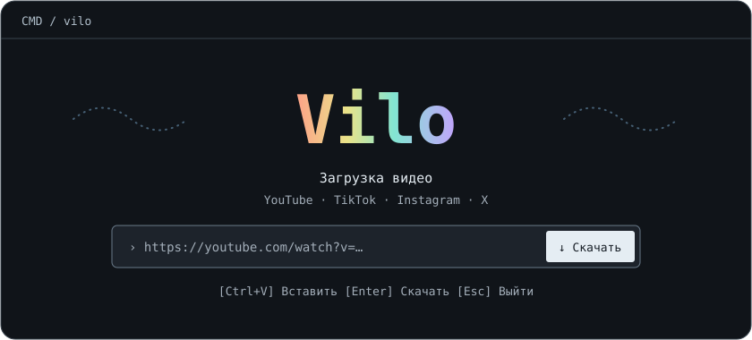

# Vilo



Paste a link. Save a video. All from Windows CMD.

Vilo downloads videos from YouTube, TikTok, Instagram, X, and other sites supported by [yt-dlp](https://github.com/yt-dlp/yt-dlp/blob/master/supportedsites.md). Paste a URL or a block of text and Vilo queues the distinct links it finds.

## Install

Requires Windows and Node.js 22 or newer. Install the download engine with WinGet, then open a new CMD window.

```cmd
winget install --source winget --id yt-dlp.yt-dlp --exact
```

Once Vilo is published to npm:

```cmd
npm install -g vilo-cli
vilo
```

To install from a local clone before the npm release, run `npm install -g .` in the repository directory.

## Use

```cmd
vilo
vilo "https://youtu.be/VIDEO_ID"
vilo --help
```

| Key | Action |
| --- | --- |
| Ctrl+V | Paste a link or text |
| Enter | Start the queue |
| Esc | Close the input screen |

Files go to `%USERPROFILE%\Downloads\Vilo`. The interface follows the terminal's colors and supports `NO_COLOR`.

## Development

```cmd
node vilo.mjs
npm pack --dry-run
```

Download videos you have permission to save. The terminal layout was inspired by [Yoinks](https://github.com/pablostanley/yoinks).
